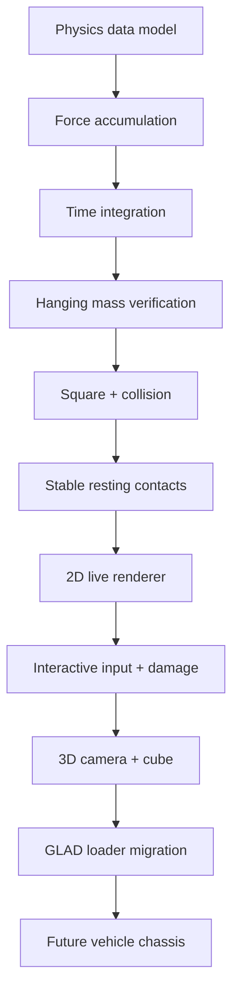

# 01 — Project Goals and Chronology

## Motivation

SoloPhysics began on **28 October 2026** with a long-term objective of a BeamNG.drive-style deformable vehicle simulator, built independently to learn C++, mathematical modelling and engine development. The important design decision was to build a **headless physics core first**, verify it numerically, and add visualisation only after the results made sense. Inspiration from node–beam vehicle physics is supported by [BeamNG's official explanation](https://www.beamng.com/game/about/physics/); the present project is an original prototype, not a recreation of the full BeamNG solver.

## Development log — 28 to 31 October 2026

| Date | Milestone | Evidence / outcome |
|---|---|---|
| **28 Oct** | Select C++20, GLM, CMake, Ninja, Git; headless-first node–beam design | Development discussion |
| **28–29 Oct** | Create `Node`, `Beam`, `PhysicsWorld` and gravity / spring forces / integration | Reviewed code fragments and user tests |
| **29 Oct** | Single suspended mass experiment; vary stiffness/damping and plasticity | Equilibrium near **1.9019 m** verified |
| **30 Oct** | Four-node, six-beam square dropped onto ground | Position and velocity output supplied |
| **30 Oct** | Replace small-contact restitution with resting threshold | Micro-bounce changed to nearly zero velocity |
| **30 Oct** | Add 2D GLFW/OpenGL renderer | User confirmed window worked |
| **30 Oct** | Add camera controls, pause/reset/gravity toggles, mouse-force dragging | User confirmed drag worked |
| **30 Oct** | Enable yielding/fracture, highlight nodes and draw drag spring | User confirmed interactive damage worked |
| **31 Oct** | Replace 2D square with 3D cube, OpenGL 3.3 shaders, orbit camera | Source bundle v0.4 verified |
| **31 Oct** | Initial 3D GLEW loader failed on user's setup; migrate to GLAD 2 | User confirmed GLAD version worked |

> [!note] Version labels
> v0.1–v0.4 are teaching/milestone labels used during our development conversations, not a claim about Git tags or formal releases. Exact commit IDs for the SoloPhysics project were not provided here.

## Why the order mattered

The sequence prevents rendering bugs from being confused with simulation bugs. For example, the 2D CLI output already proved the nodes were moving before any shaders were written. Likewise, terminal damage counts can distinguish physics failure from incorrect beam colouring.

## Fundamental architectural choices

- **Simulation is separate from graphics:** the renderer receives a `const PhysicsWorld&`; it reads state but does not integrate equations.
- **Real units:** positions in metres, masses in kilograms, acceleration in m/s², force in newtons; spring coefficient in N/m, damping in N·s/m.
- **Deterministic-size steps:** `1/240 s` in interactive v0.3–v0.4. This is not a claim of fully deterministic cross-platform behaviour.
- **Explicit topology:** beams store *indices*, not owning pointers to nodes, so the world can store nodes in a `std::vector`.
- **Per-beam failure state:** `broken` prevents the spring from transmitting force; `plasticallyDeformed` records historical deformation for display.

## Roadmap decision log

**Initially chosen:** straightforward mass–spring–damper with semi-implicit Euler. **Deferred:** FEM, XPBD, constrained contacts, self-collision, spatial acceleration structures, full vehicle dynamics, solver calibration and multithreading. Their absence is an intentional scope boundary rather than evidence they are solved.

See [[18 - Limits and Future Roadmap]] and [[19 - Bibliography and Attribution]].
