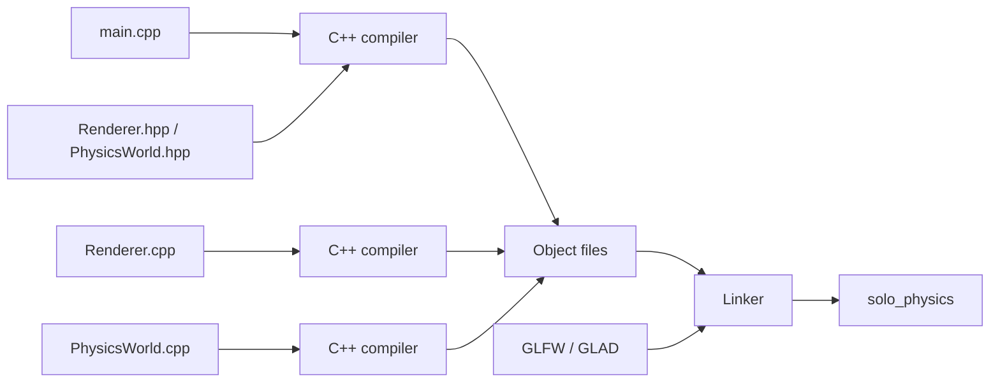

# 02 — Environment, Project Layout and Build

## Hardware and operating environment

The project is developed on **SoloLinux**, an Arch-derived Linux setup, using a C++20 compiler (`g++` in the recorded build logs), GLFW, GLM, Mesa/OpenGL, CMake, Ninja and later GLAD 2. The user was running a Hyprland/Wayland desktop when the GLEW loader problem was investigated.

```bash
sudo pacman -S --needed git python python-jinja glfw glm mesa cmake ninja
cd ~/Projects/SoloPhysics
cmake -S . -B build-glad -G Ninja
cmake --build build-glad
./build-glad/solo_physics
```

- `sudo pacman -S --needed`: installs only missing packages.
- `cmake -S .`: source directory is here.
- `-B build-glad`: binary/build directory is a separate location.
- `-G Ninja`: choose Ninja as the build-system generator.
- `cmake --build`: execute that generator with dependency checking.
- `&&`: run the next command **only if the previous command succeeded**; prevents launching a stale executable after a failed compile.

## File structure

```text
SoloPhysics/
├── CMakeLists.txt
├── include/solophysics/
│   ├── Vector3D.hpp
│   ├── Node.hpp
│   ├── Beam.hpp
│   ├── PhysicsWorld.hpp
│   └── Renderer.hpp
├── src/
│   ├── main.cpp
│   ├── physics/PhysicsWorld.cpp
│   └── rendering/Renderer.cpp
└── build-glad/       # generated; do not edit by hand
```

**Headers** (`.hpp`) describe interfaces and shared types. **Implementation files** (`.cpp`) define functions. `main.cpp` assembles the demo and owns the application loop. A larger engine could split tests into a separate target and move the engine into a library.

## Compilation mental model (from Python to C++)

Python often imports a module at runtime. C++ typically uses a **preprocessor**, **compiler**, **linker**, then a native executable:



`#include <solophysics/Renderer.hpp>` effectively makes declarations available to the current translation unit. It is **not** a runtime package import. A missing declaration causes a compile error; a declaration without a matching compiled definition can cause a linker error.

## Git safeguards

```bash
git status --short
git add CMakeLists.txt include src
git commit -m "Document current working GLAD renderer"
git log --oneline --max-count=10
```

These are example commands; the exact history and branch state depend on your repository. Commit before replacing generated upgrade files. See [[16 - Errors, Diagnostics and Lessons]].
