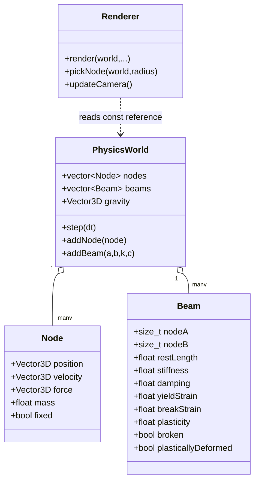

# 04 — Core Data Model and Source Architecture

## Core model

The simulation is a graph: **nodes are vertices**, and **beams are undirected edges**. Each node has state (mass, position, velocity, accumulated force); each beam refers to two node indices and describes its constitutive behaviour.



## `Vector3D.hpp`: descriptive alias

Recorded design:

```cpp
#pragma once
#include <glm/vec3.hpp>
namespace solophysics {
    using Vector3D = glm::vec3;
}
```

**Interpretation:** `Vector3D` and `glm::vec3` denote the same underlying type. GLM supplies vector addition, scalar multiplication, dot products and lengths. Using an alias makes a future math-library replacement easier conceptually, though replacing GLM would require more work than just the alias.

## `Node.hpp`: mass particle

Recorded prototype (illustrative reconstruction of the earlier header):

```cpp
struct Node {
    Vector3D position{0.0f};
    Vector3D velocity{0.0f};
    Vector3D force{0.0f};
    float mass = 1.0f;
    bool fixed = false;
};
```

**Units:** `position` m, `velocity` m/s, `force` N, `mass` kg. A fixed node should not be numerically integrated. The `force` field stores the **sum of forces for the current timestep**, not a permanent applied force.

## `Beam.hpp`: connected spring/damper

Recorded interface (field ordering may differ locally):

```cpp
struct Beam {
    std::size_t nodeA = 0;
    std::size_t nodeB = 0;
    float restLength = 0.0f;
    float stiffness = 1000.0f;
    float damping = 10.0f;
    float yieldStrain = 0.15f;
    float breakStrain = 0.60f;
    float plasticity = 2.0f;
    bool plasticDeformationEnabled = true;
    bool plasticallyDeformed = false;
    bool broken = false;
};
```

The beam has no separate mass or bending DOF. `nodeA`, `nodeB` are **indices** into `world.nodes`. `restLength` is the length at which the spring's elastic component is zero. Later plastic deformation mutates that value, so original-length-based comparisons would require a separate original-length field.

## `PhysicsWorld`: responsible for one step

The previously recorded step sequence:

```cpp
void PhysicsWorld::step(float dt) {
    // timestep validation
    validateState();
    resetForces();
    applyExternalForces();
    if (externalForceCallback) externalForceCallback(*this);
    solveBeamForces();
    integrate(dt);
    detectAndResolveGroundContacts();
    updateDamage(dt);
    validateState();
}
```

This is a *recorded conceptual sequence*, not a byte-for-byte snapshot of the newest local `PhysicsWorld.cpp`. Its order has physical consequences: using forces from the current positions for integration; applying ground corrections after integration; and evaluating breakage after movement means a breaking beam may still have contributed a force during the immediately preceding timestep.

## Why separate responsibilities?

`main.cpp` constructs a test **scenario**, processes UI events and calls physics/render. `PhysicsWorld.cpp` evolves the physical state. `Renderer.cpp` converts the latest state to GPU draw commands. As a result, the same physics core could be called by command-line tests, a 2D renderer, a 3D renderer or (later) a headless benchmark.

**Mental model from Python:** `PhysicsWorld` is the domain model, `Renderer` is a view, and `main.cpp` is the controller/application entry point. Unlike a typical pure-Python application, the C++ declarations, definitions, template instantiations and linker all have to agree.

Read alongside source snapshots `Source Snapshots/v0.4-GLAD/src/main.cpp` and `.../Renderer.cpp`. See also [[05 - Forces and Spring Dynamics]] and [[15 - CMake Deep Dive]].
