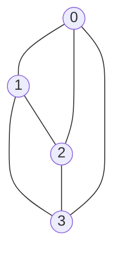

# 08 — Square Drop, Impact and Resting-Contact Fix

## From one spring to a connected structure

The 2D test replaced the suspended node with four nodes placed in the XY plane:

| Node | Initial position (m) |
|---|---|
| 0, top left | $(-0.5,3,0)$ |
| 1, top right | $(0.5,3,0)$ |
| 2, bottom left | $(-0.5,2,0)$ |
| 3, bottom right | $(0.5,2,0)$ |

Six beams connected four perimeter edges and two crossing diagonals. Diagonal cross-bracing stops the square becoming an unconstrained pin-jointed parallelogram. With $k=1000$ N/m, $c=10$ N·s/m and each node of mass 1 kg, the shape began falling from rest.



(The diagram is connectivity, not the actual screen positions.)

## Baseline free fall

Before contact, all four nodes experienced almost identical downward motion. At $t=0.25$ s, the reported speed was approximately $v_y=-2.4525$ m/s, matching $-gt=-9.81\times0.25$.

At $t=0.50$ s, $v_y=-4.9050$ m/s and bottom nodes were at $y=0.7635$ m. These are valuable baseline checks: internal beams should not create a net external force on an initially undeformed freely falling assembly.

The bottom starts at 2 m, so continuous ideal free-fall predicts first contact near

$$t_{impact}=\sqrt{2h/g}=\sqrt{4/9.81}\approx0.639\,\mathrm s.$$

The logged data at 0.75 s already showed impact, rebound and compression.

## The micro-bouncing bug

The original ground solver clamped below-ground positions to $y=0$ and multiplied downward velocity by a restitution coefficient. At rest, gravity repeatedly caused tiny penetration; the solver repeatedly reversed velocity. Earlier results showed bottom nodes at $y=0$ but with persistent $v_y\approx+0.0136$ m/s. That is an **artefact** of the contact correction, not physical perpetual bouncing.

A simple resting threshold was introduced:

```cpp
constexpr float restingVelocityThreshold = 0.2f;
if (node.position.y < groundY) {
    node.position.y = groundY;
    if (node.velocity.y < 0.0f) {
        float impactSpeed = -node.velocity.y;
        node.velocity.y = impactSpeed < restingVelocityThreshold
                        ? 0.0f
                        : -node.velocity.y * restitution;
    }
    node.velocity.x *= (1.0f - friction);
    node.velocity.z *= (1.0f - friction);
}
```

The displayed post-fix results settled to bottom $y=0$, $v_y=0$ (at print precision) and upper $y\approx0.9926$ m by approximately 2.5 s. This was successful for the test.

> [!warning] Not a physically complete contact solver
> This is a position clamp and velocity heuristic. It does not compute persistent normal impulses, static friction constraints, or continuous collision detection. Multiplying tangential velocity by `(1 - friction)` each contact step is framerate/step-dependent and not Coulomb friction. Do not treat it as a production crash solver.

## Why the final upper height was below 1 m

At rest, the bottom row sits at $y=0$ while the upper row is around $0.9926$ m, slightly lower than the square's original 1 m height. The network's axial springs are carrying gravitational loads and compressing. The exact load distribution depends on beam topology and constraints, so do not apply the single-hanging-mass formula blindly to the square.

This experiment validated a multi-node topology, elastic loads, impact response and the importance of separating numerical artefacts from genuine material behaviour.
