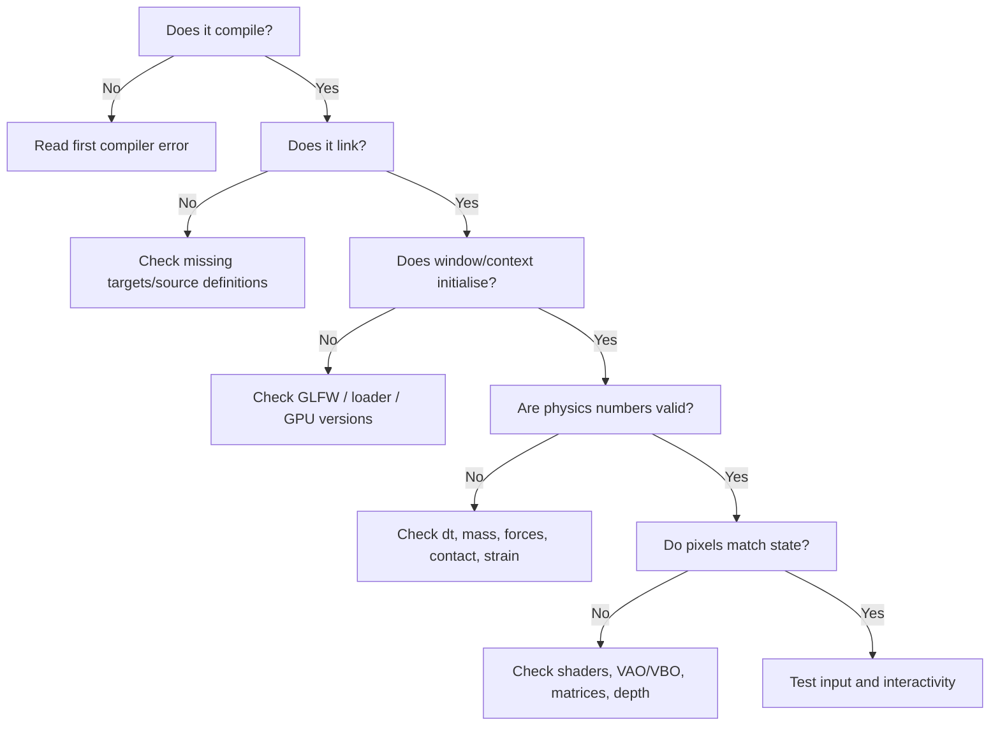

# 16 — Real Errors, Diagnostics and Lessons

## Debugging timeline

| Symptom | Observed cause / diagnosis | Fix | General lesson |
|---|---|---|---|
| Changing damping seemed ineffective | A local `main.cpp` edit wasn't saved before build | Save, then rebuild; print config values | Verify inputs and build freshness |
| Bottom nodes sat at ground with positive vertical velocity | Repeated tiny penetration plus restitution | Small-speed resting threshold | Contact impulses require persistent resting treatment |
| Clicking seemed to do nothing | Small picking radius / unclear mouse-to-world state | Print cursor world coords; increase radius; show selected node | Inspect each link in input→selection→force chain |
| Dragging not acting through physics | Node force assigned before `resetForces()` | Add callback inside step between reset and integration | Put state updates in correct stage |
| Beams never turned orange/broke | `plasticDeformationEnabled=false`, `breakStrain=100` remained set | Enable plasticity, lower test thresholds, anchor a node | Verify actual configuration, not the intended one |
| `i was not declared in this scope` | `world.nodes[i]` written outside `for(std::size_t i...)` | Move fixed-node `continue` inside indexed loop | Scope is lexical; `continue` is loop-only |
| Copying instructions into `Renderer.cpp` caused invalid C++ | Markdown explanatory text/code fences were pasted into `.cpp` | Replace file with clean source | Code blocks ≠ prose instructions |
| `Failed to initialise GLEW: Missing GL version` | Runtime loader/context incompatibility suspected | Migrate loader to GLAD 2 | Distinguish loader from GPU/shader/physics |
| CMake still said `Found GLEW` after naming build folder `build-glad` | Patch ZIP absent; `unzip` failed; source still used GLEW | Actually download/extract patch, verify `grep` results | Directory names do not change source |

## Reproducible debugging funnel



## What `ninja: no work to do` actually means

It means Ninja believes its declared inputs/outputs are up-to-date; it does **not** prove your program uses the source you *intended* to copy. Verify path, file contents, CMake configure output and the executable invoked. Use `cmake --build build-glad --verbose` when necessary to inspect compiler/linker commands.

## Warnings versus errors

The v0.4 build log included `warning: variable 'steps' set but not used`. Warnings typically do not stop compilation with the current options; they should still be addressed because they can reveal dead code or mistaken state handling. `-Wall -Wextra -Wpedantic` increases diagnostic visibility.

## Useful SoloLinux commands

```bash
pwd
find include src -maxdepth 3 -type f | sort
rg -n 'GLEW|glad|externalForceCallback|updateDamage' include src CMakeLists.txt
cmake --build build-glad --verbose
./build-glad/solo_physics
git diff --stat
git diff -- src/main.cpp
```

`rg` is ripgrep; use regular `grep -R` if unavailable. The `git diff` commands inspect uncommitted changes.

## The rule: measure before changing

When debugging a simulator, log meaningful invariants: node count, beam count, node mass, dt, position, velocity, force, rest length, strain, broken count and plastic-history count. **Change one variable at a time**. A powerful diagnostic order is: numerical state → force signs → picking → rendering. Never use just the visual cube as a correctness oracle.
